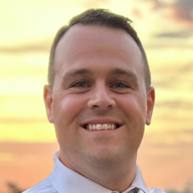
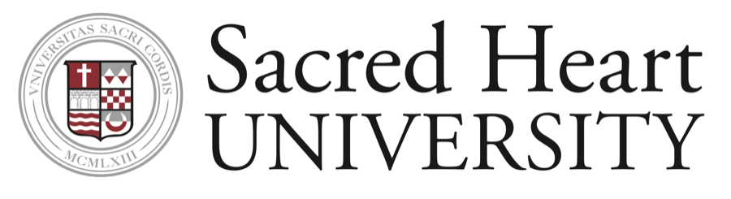

<a class="back" href="/">&larr; Home</a>

<h1>Paul M. Carrier</h1>

Senior Software Engineer | Cloud Capacity &amp; Platform Engineering

<a href="mailto:paulmcarrier@gmail.com">paulmcarrier@gmail.com</a>

Senior Software Engineer with 10+ years in cloud infrastructure, DevOps, and platform engineering. Builds Python and TypeScript tooling that automatically scales a large AWS platform for high-traffic live events and streaming debuts on Disney+ and Hulu. Leads projects from PRD to delivery, performs design reviews, and mentors junior engineers.

<h2>Experience</h2>

<h3>The Walt Disney Company</h3>

Senior Software Engineer, Capacity Management

Nov 2021 – PresentRemote

<ul>
<li>Build and maintain Python and TypeScript tooling that scales Disney's cloud platform, running on AWS EKS and ECS.</li>
<li>Automate capacity for 2,000+ AWS resources, making thousands of scaling adjustments per day across Auto Scaling Groups, ECS services, EKS pods, ALB LCUs, and DynamoDB read/write capacity.</li>
<li>Lead scaling for high-traffic tentpole events, including NFL games, the Oscars, election coverage, WWE, UFC, and major Disney+ and Hulu premieres.</li>
<li>Lead projects end to end, from PRD through design, implementation, and delivery.</li>
<li>Perform design reviews and mentor junior engineers on the team.</li>
<li>Use an AI-driven development workflow to deliver tooling faster.</li>
</ul>

<h3>Airtank Inc.</h3>

Senior Operations Engineer

Nov 2018 – Nov 2021Remote (Peterborough, NH)

<ul>
<li>Built and maintained the infrastructure stack (Kubernetes, Elasticsearch, DynamoDB) for Ziftrshop, a headless, API-driven enterprise e-commerce platform.</li>
<li>Reduced cost and deployment time by building and maintaining CI/CD pipelines and tooling.</li>
<li>Supported client and internal infrastructure in the cloud and on premises.</li>
<li>Drove DevOps culture across the company through policy change and hands-on work.</li>
<li>Managed on-call schedules and incident response for developers and operations staff.</li>
<li>Maintained PCI compliance for internal projects and supported customers as a sales engineer.</li>
</ul>

<h3>IO Education / Illuminate Education</h3>

Senior DevOps Engineer

Jan 2017 – Nov 2018Remote (Atlanta, GA / Irvine, CA)

<ul>
<li>Supported AWS infrastructure and guided 5 development teams across separate product lines.</li>
<li>Maintained CI/CD pipelines and took part in the on-call support rotation.</li>
<li>Acted as operations liaison in product planning meetings.</li>
</ul>

<h3>MyVBO / Ziftr LLC</h3>

DevOps Engineer

Jul 2015 – Dec 2016Remote (Merrimack, NH)

<ul>
<li>Supported AWS application infrastructure and built automation (Chef, Jenkins, OpsWorks) for continuous delivery.</li>
<li>Managed incident response and led recovery during major service interruptions.</li>
<li>Maintained PCI compliance documentation and verified security standards through penetration testing.</li>
</ul>

<h2>Skills</h2>

PythonTypeScriptNode.jsBashEC2Auto ScalingEKSECSALBDynamoDBCloudFormationCloudFrontCloudWatchRDSS3VPCRoute 53KubernetesDockerNginxGitHub ActionsPagerDutyAtlassianLinux

<h2>Education</h2>

<strong>Bachelor of Science, Natural Sciences</strong> Fairfield, CT · 2011

